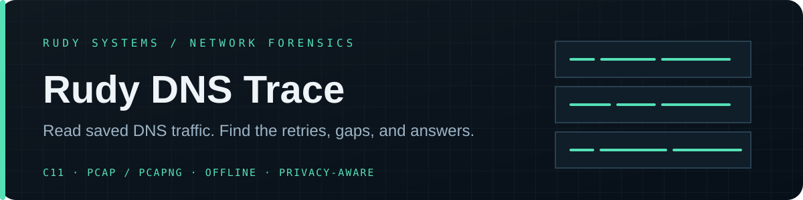

<div align="center">
  

  <p><strong>Offline DNS capture analysis for incident response and network troubleshooting.</strong></p>

  <p>
    <a href="https://github.com/r4venrudy/rudy-dns-trace/actions/workflows/ci.yml"></a>
    <a href="https://github.com/r4venrudy/rudy-dns-trace/releases"></a>
    
    
  </p>
</div>

## Investigate DNS from a capture, without touching the network

Rudy DNS Trace reads saved **PCAP and PCAPNG** files and reconstructs DNS query transactions. It correlates retries and replies, measures observed latency, counts response codes, and exports reviewable text, JSON, or CSV. It is a native C11 command-line tool with bounded parsing and no packet-capture dependency.

Use it to answer practical questions from a capture: which names were queried, which replies were slow or missing, how often did clients retry, and which responses returned errors? It is designed for authorized incident response, lab analysis, and troubleshooting.

## What it does

| Capability | Details |
| --- | --- |
| Reads common capture formats | Classic PCAP (little/big endian, microsecond/nanosecond) and PCAPNG sections, interfaces, enhanced and simple packet blocks |
| Decodes network layers | Ethernet, up to four VLAN tags, Linux cooked v1/v2, BSD null/loopback, raw IPv4/IPv6, and bounded IPv6 extension headers |
| Reconstructs DNS activity | UDP/53 and complete length-prefixed DNS-over-TCP messages present in one captured packet; reports retries, response code, answer count, and latency |
| Flags incomplete evidence | Counts malformed packets and DNS, capture truncation, skipped fragments, unsupported link types, incomplete TCP DNS, and unmatched replies |
| Exports portable reports | Human-readable text, JSON with a versioned schema, or CSV; cap output rows with `--max-results` |
| Redacts before sharing | Independently replace IP addresses and queried names with `--redact-ips` and `--redact-names` |
| Limits untrusted input | Bounds packet and block sizes, interface count, DNS section counts, name decoding, and retained transactions |

## Quick start

Download the archive for your operating system from [Releases](https://github.com/r4venrudy/rudy-dns-trace/releases), extract it, then run:

```text
rudy-dns-trace analyze authorized-capture.pcapng --format text
```

Write structured output and redact sensitive fields before sharing:

```text
rudy-dns-trace analyze authorized-capture.pcap --format json --redact-ips --redact-names > dns-report.json
rudy-dns-trace analyze authorized-capture.pcapng --format csv --max-results 500 > dns-report.csv
```

The report includes capture totals and a transaction table. JSON consumers can check `schema` (`rudy-dns-trace/v1`) and the `redacted` flags. An “unanswered” query means no matching response was present in this capture; it does not prove the resolver failed.

See [examples/README.md](examples/README.md) for a synthetic report walkthrough and [docs/CONTRACT.md](docs/CONTRACT.md) for supported records, matching rules, and parser limits.

## Build from source

Requirements: CMake 3.20 or newer and a C11 compiler (GCC, Clang, or MSVC).

```sh
cmake -S . -B build -DCMAKE_BUILD_TYPE=Release
cmake --build build --config Release
ctest --test-dir build -C Release --output-on-failure
```

Install the executable and documentation:

```sh
cmake --install build --config Release --prefix install
```

On Linux, run parser tests under AddressSanitizer and UndefinedBehaviorSanitizer:

```sh
cmake -S . -B build-asan -DCMAKE_BUILD_TYPE=Debug -DRDT_ENABLE_SANITIZERS=ON
cmake --build build-asan --parallel
ctest --test-dir build-asan --output-on-failure
```

Tests generate synthetic PCAP and PCAPNG fixtures in the build directory; they do not require or include real user traffic. GitHub Actions builds and tests on Linux, Windows, and macOS.

## Boundaries

Rudy DNS Trace is **offline-only**. It never opens a live capture device, sends packets, resolves names, contacts external services, uploads captures, or changes host configuration. Supply only captures you are authorized to inspect.

It does not reassemble TCP streams, IP fragments, or DNS messages split across packets. DNS-over-TCP is counted only when a complete length-prefixed message is contained in one captured packet. Encrypted DNS (DoT/DoH/DoQ), arbitrary DNS record data, DNSSEC validation, and threat verdicts are outside its scope. Capture loss can make observed retries, response timing, or unanswered queries incomplete.

Reports contain client/resolver addresses and queried names by default. Apply both redaction flags before sharing if those fields are sensitive. Redaction affects report output; it does not alter or sanitize the original capture.

## Project notes

- [Security policy](SECURITY.md)
- [Contribution guide](CONTRIBUTING.md)
- [Parser contract and limitations](docs/CONTRACT.md)
- Standards: [DNS message format (RFC 1035)](https://www.rfc-editor.org/rfc/rfc1035.html) · [DNS over TCP (RFC 7766)](https://www.rfc-editor.org/rfc/rfc7766.html) · [PCAPNG specification](https://pcapng.com/)

<div align="center">
  <sub>Built for careful packet analysis by <a href="https://rudy.systems">Rudy Systems</a> · C11 · MIT</sub>
</div>
